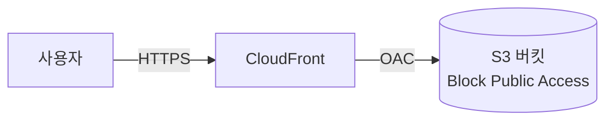

# Static_Web_Hosting
Host the Static Website using AWS Resources(S3 + CloudFront)

# AWS Study Notes

> AWS CLF-C02(기본)와 SAA-C03(심화) 학습 내용을 정리한 웹 기반 스터디 노트.
> S3 + CloudFront로 직접 배포하고 운영하고 있습니다.

🔗 **Live:** https://d1yafwlyk0bqb2.cloudfront.net
📅 개발 기간: 2026.11.09 ~ 진행 중 (현재 Phase 8)

<!-- 스크린샷 1: Home 대시보드 (가로 전체 폭) -->


---

## 왜 만들었나

시험 준비용 노트가 늘어나면서 하나의 긴 페이지에서 원하는 내용을 찾기 어려워졌습니다.
그래서 실제로 쓰면서 불편한 점을 하나씩 고치는 방식으로 개발했고, 지금은 도메인별 학습, 통합 검색, 기본/심화 분류를 갖춘 학습 사이트가 되었습니다.

## 주요 기능

| 기능 | 설명 |
| --- | --- |
| 도메인별 학습 | CLF-C02 4개 도메인을 카드로 보여주고, 선택한 도메인의 내용과 목차만 표시 |
| 기본 / 심화 분류 | CLF 기본 내용과 SAA 수준의 Advanced Topics를 구분해 표시 |
| 통합 검색 | 전체 60개 섹션 대상 AND 검색, 제목 우선 정렬, 본문 미리보기, 결과 클릭 시 해당 도메인으로 자동 이동 |
| 목차 접기 | 사이드바를 접고 펼쳐 본문에 집중 (aria 속성 적용) |
| 반응형 | CSS Grid 기반 2단 레이아웃, 모바일 대응 |

<!-- 스크린샷 2, 3: 도메인 학습 화면 / 검색 결과 화면 (나란히) -->
| 도메인 학습 | 통합 검색 |
| --- | --- |
|  |  |

## 아키텍처



- **S3:** Block Public Access를 켜서 직접 접근을 차단하고, 버킷 정책으로 CloudFront OAC의 요청만 허용
- **CloudFront:** S3를 Origin으로 사용하고 엣지 캐싱으로 콘텐츠 전달
- **HTTPS:** Viewer Protocol Policy를 'Redirect HTTP to HTTPS'로 설정
- **배포:** 파일을 S3에 업로드한 뒤 CloudFront Invalidation으로 캐시 갱신 (서울 리전)

## 기술 스택

HTML5 · CSS3 · JavaScript · Font Awesome 6.7.2 · Amazon S3 · Amazon CloudFront

## 개발 이력

| Phase | 내용 |
| --- | --- |
| 1 | 단일 HTML 학습 노트, 목차·앵커 이동, 반응형 2단 레이아웃 |
| 2 | `search.js` 분리, AND 검색과 결과 미리보기 |
| 3–5 | 검색 UI 개선, 사이드바 접기 기능, SVG 아이콘과 접근성 개선 |
| 6 | Home 대시보드, 도메인 카드, 페이지 전환 |
| 7 | `data-domain` / `data-level` 기반 도메인 필터링 |
| 8 | Home과 Study가 같은 데이터를 쓰는 통합 검색, 검색 결과 클릭 시 자동 전환 |

각 Phase의 문제 상황, 구현 내용, 배운 점은 [상세 개발 기록](AWS_Certificate_Studynote/README.md)에 정리했습니다.

## 저장소 구조

```
Static_Web_Hosting/
├── AWS_Certificate_Studynote/   # 사이트 소스와 상세 개발 기록
└── docs/images/                 # README용 스크린샷

```

## 앞으로의 계획

- [ ] GitHub Actions로 S3 업로드와 CloudFront Invalidation 자동화
- [ ] Terraform으로 S3 · CloudFront · OAC 구성 코드화
- [ ] 모바일 사용성 개선
