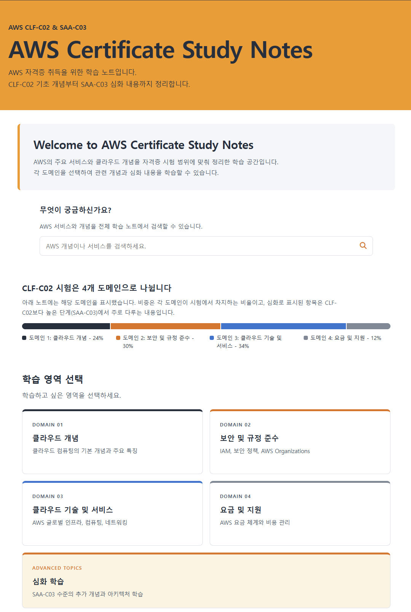
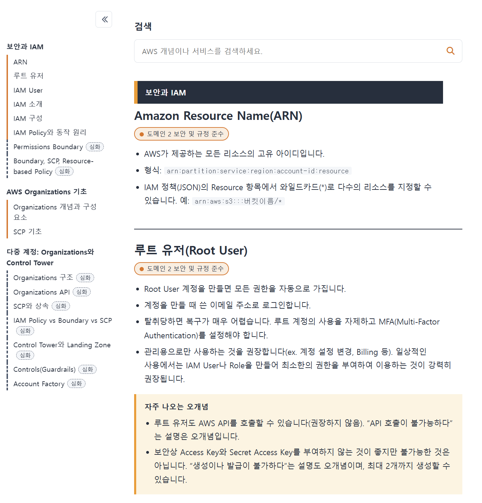
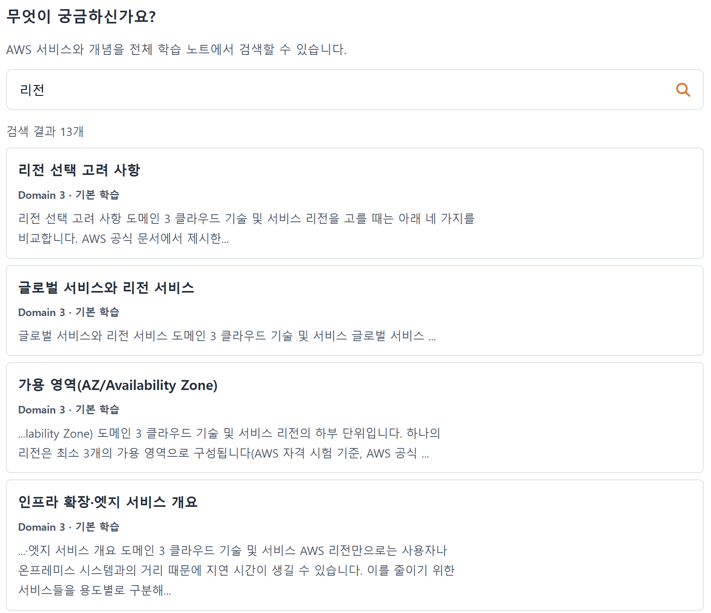
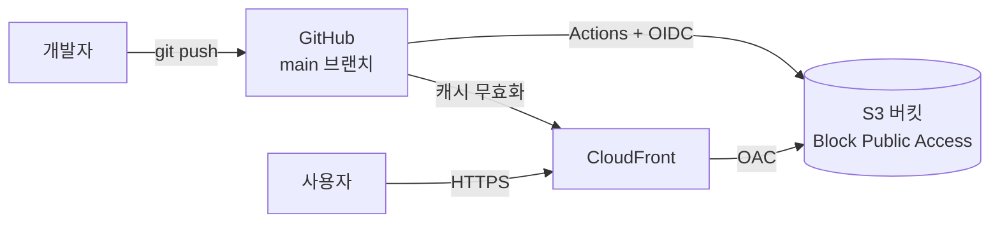

# AWS Study Notes


> AWS CLF-C02(기본)와 SAA-C03(심화) 학습 내용을 정리한 웹 기반 스터디 노트.
> S3 + CloudFront로 직접 배포하고 운영하고 있습니다.

🔗 **Live:** https://d1yafwlyk0bqb2.cloudfront.net
📅 개발 기간: 2026.11.09 ~ 진행 중 (현재 Phase 8)




---

## 왜 만들었나

시험 준비용 노트가 늘어나면서 하나의 긴 페이지에서 원하는 내용을 찾기 어려워졌습니다.
그래서 실제로 쓰면서 불편한 점을 하나씩 고치는 방식으로 개발했고, 지금은 도메인별 학습, 통합 검색, 기본/심화 분류를 갖춘 학습 사이트가 되었습니다.

## 주요 기능

| 기능 | 설명 |
| --- | --- |
| 도메인별 학습 | CLF-C02 4개 도메인을 카드로 보여주고, 선택한 도메인의 내용과 목차만 표시 |
| 기본 / 심화 분류 | CLF 기본 내용과 SAA 수준의 Advanced Topics를 구분해 표시 |
| 통합 검색 | 전체 60개 섹션 대상 AND 검색, 제목 우선 정렬, 본문 미리보기, 결과 클릭 시 해당 도메인으로 자동 이동 |
| 목차 접기 | 사이드바를 접고 펼쳐 본문에 집중 (aria 속성 적용) |
| 반응형 | CSS Grid 기반 2단 레이아웃, 모바일 대응 |


| 도메인 학습 | 통합 검색 |
| --- | --- |
|  |  |

## 아키텍처



- **S3:** Block Public Access로 직접 접근을 차단하고, 버킷 정책으로 지정한 CloudFront 배포의 OAC 요청만 허용 (버킷 리전: us-east-1)
- **CloudFront:** S3를 Origin으로 사용하고 엣지 캐싱으로 콘텐츠 전달
- **HTTPS:** Viewer Protocol Policy를 `Redirect HTTP to HTTPS`로 설정
- **배포:** `main` 브랜치에 `site/` 변경이 push되면 GitHub Actions가 S3 동기화와 CloudFront 캐시 무효화를 자동 실행

## 배포 자동화 (CI/CD)

콘솔로 수동 업로드하던 배포를 GitHub Actions로 자동화했습니다.

**흐름:** `site/` 수정 → `git push` → Actions 실행 → S3 동기화(`aws s3 sync --delete`) → CloudFront 캐시 무효화

**설계 포인트**
- **장기 액세스 키를 쓰지 않습니다.** GitHub OIDC로 임시 자격 증명을 발급받는 방식이라 저장소에 AWS 키가 존재하지 않습니다.
- **최소 권한의 IAM 역할을 씁니다.** 해당 버킷에 대한 목록 조회·업로드·삭제와 해당 배포의 캐시 무효화만 허용했습니다.
- **이 저장소의 `main` 브랜치에서 실행된 워크플로만** 역할을 맡을 수 있도록 신뢰 정책으로 제한했습니다.
- **`site/` 변경 시에만 배포**되도록 경로 조건을 걸어, README나 문서 수정으로는 배포가 실행되지 않습니다.
- 버킷 이름, 배포 ID, 역할 정보는 코드에 적지 않고 GitHub Secrets로 분리했습니다.
- 첫 적용 때는 `--dryrun`으로 삭제 대상이 없는지 먼저 확인한 뒤 실제 배포로 전환했습니다.

### 트러블슈팅: OIDC 역할 맡기 실패

- **증상:** Actions에서 `Not authorized to perform sts:AssumeRoleWithWebIdentity` 오류
- **원인:** IAM 신뢰 정책의 `sub` 조건을 `repo:소유자/저장소:ref:refs/heads/main` 형식으로 작성했지만, GitHub가 실제로 보내는 값에는 소유자와 저장소의 숫자 ID가 포함된 형식이었음
- **해결:** 워크플로에 임시 디버그 단계를 넣어 실제 토큰의 `sub`, `aud` 값을 출력해 확인하고, 그 값으로 신뢰 정책을 수정
- **배운 점:** 문서나 예시를 그대로 믿기보다 실제로 전달되는 값을 확인해야 한다. 디버그 출력에 비밀 값이 섞이지 않는지도 점검해야 한다.

## 기술 스택

HTML5 · CSS3 · JavaScript · Font Awesome 6.7.2 · Amazon S3 · Amazon CloudFront · GitHub Actions

## 개발 이력

| Phase | 내용 |
| --- | --- |
| 1 | 단일 HTML 학습 노트, 목차·앵커 이동, 반응형 2단 레이아웃 |
| 2 | `search.js` 분리, AND 검색과 결과 미리보기 |
| 3–5 | 검색 UI 개선, 사이드바 접기 기능, SVG 아이콘과 접근성 개선 |
| 6 | Home 대시보드, 도메인 카드, 페이지 전환 |
| 7 | `data-domain` / `data-level` 기반 도메인 필터링 |
| 8 | Home과 Study가 같은 데이터를 쓰는 통합 검색, 검색 결과 클릭 시 자동 전환 |
| Infra | 소스를 GitHub `site/`로 관리하고, GitHub Actions + OIDC로 S3 배포와 CloudFront 캐시 무효화를 자동화 |

각 Phase의 문제 상황, 구현 내용, 배운 점은 [상세 개발 기록](AWS_Certificate_Studynote/README.md)에 정리했습니다.

## 저장소 구조

```
Static_Web_Hosting/
├── .github/workflows/           # 배포 자동화 워크플로
├── site/                        # S3로 배포되는 사이트 소스
├── AWS_Certificate_Studynote/   # 상세 개발 기록
└── docs/images/                 # README용 스크린샷
```

## 앞으로의 계획

- [x] GitHub Actions로 S3 업로드와 CloudFront Invalidation 자동화
- [ ] Terraform으로 S3 · CloudFront · OAC 구성 코드화
- [ ] 모바일 사용성 개선
